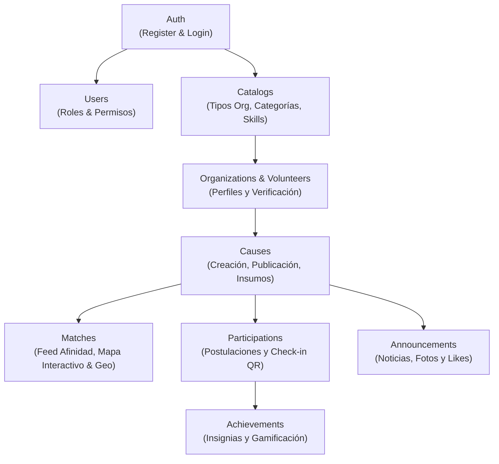

# Kindly API — Postman Collection & Environment

Este directorio contiene la colección de Postman y el entorno local para la prueba integral de los endpoints HTTP del backend de Kindly (**NestJS + TypeORM + PostgreSQL**).

---

## 1. Archivos Incluidos

- **`Kindly-Backend.postman_collection.json`**: Colección completa (`Kindly API`) organizada en 10 carpetas por dominio de negocio, abarcando todos los módulos y controladores expuestos en la rama activa.
- **`Kindly-Local.postman_environment.json`**: Entorno local (`Kindly Local`) preconfigurado con variables base (`baseUrl`), tokens JWT dinámicos (`adminToken`, `volunteerToken`, `organizationToken`, `authToken`), coordenadas geográficas e IDs de prueba.
- **`README.md`**: Esta guía de importación, configuración, ejecución y especificación de endpoints.

---

## 2. Prerrequisitos de Ejecución

1. **Instancia de PostgreSQL Activa**:
   - Puerto por defecto: `5433` (configurable en `server/.env` vía `POSTGRES_PORT`).
   - Base de datos requerida: `kindly_db`.
2. **Variables de Entorno del Backend (`server/.env`)**:
   - Verificar la configuración local tomando como base `server/.env.example`.
   - Puerto del servidor en `main.ts`: **`3001`** (`process.env.PORT ?? 3001`).
   - La variable `baseUrl` en Postman apunta a `http://localhost:3001`.
3. **Servidor en Ejecución**:
   ```bash
   cd server
   npm run start:dev
   ```

---

## 3. Instrucciones de Importación en Postman

1. Abre **Postman**.
2. Haz clic en **Import** (esquina superior izquierda).
3. Selecciona o arrastra los dos archivos:
   - `Kindly-Backend.postman_collection.json`
   - `Kindly-Local.postman_environment.json`
4. En el selector de entorno (esquina superior derecha), activa: **`Kindly Local`**.

---

## 4. Estructura de la Colección y Flujo de Trabajo

La colección `Kindly API` está estructurada en carpetas temáticas para reflejar el ciclo de vida de la aplicación:



### Organización por Dominios

| Carpeta | Descripción | Autenticación Requerida |
| :--- | :--- | :--- |
| **Auth** | Registro e inicio de sesión de voluntarios y organizadores, consulta de perfil (`/auth/profile`) y validaciones de credenciales. Los logins actualizan automáticamente los tokens correspondientes en el entorno. | Pública / Bearer |
| **Users** | Administración de usuarios (filtros, activación, cambio de rol), roles del sistema, permisos granulares y asignación rol-permiso. Incluye subcarpeta de scaffolding directo. | Admin (`adminToken`) |
| **Catalogs** | Taxonomía base del sistema: tipos de organizaciones, categorías temáticas de voluntariado y catálogo de habilidades. | Pública / Admin |
| **Organizations** | Creación y actualización de perfiles de organización, envío de documentos legales de soporte, consulta de estado de verificación y revisión administrativa. | Organizador (`organizationToken`) / Admin |
| **Volunteers** | Perfil de voluntario, asignación de habilidades (`Volunteer Skills`) e intereses temáticos (`Volunteer Categories`). | Voluntario (`volunteerToken`) / Admin |
| **Causes** | Creación de causas, publicación, control de cupos, insumos requeridos (`Supplies`) y galería de imágenes (`Cause Images`). | Organizador (`organizationToken`) |
| **Matches** | Algoritmos de descubrimiento y afinidad: feed swipe (`Get cause deck`), feed personalizado (`Get personalized feed`), interacción swipe right/left, mapa interactivo (`pins`, `preview`), búsqueda radial (`nearby`) y caja delimitadora (`area`). | Voluntario (`volunteerToken`) |
| **Participations** | Postulación de voluntarios a causas, aceptación o rechazo por el organizador, generación de código QR y validación presencial de asistencia. | Voluntario / Organizador |
| **Announcements** | Publicación de noticias y actualizaciones por causa, adjuntos fotográficos y sistema comunitario de likes. | Organizador / Voluntario |
| **Achievements** | Catálogo de insignias y logros, otorgamiento a voluntarios y consulta de insignias ganadas por usuario. | Voluntario / Admin |

---

## 5. Endpoints de Descubrimiento y Matching (`Matches`)

La carpeta **Matches** contiene la implementación completa de descubrimiento geográfico y afinidad:

1. **`Get cause deck`** (`GET /matches/deck?limit=10&page=1`):
   - Genera el mazo de causas disponibles con cálculo dinámico de puntuación de afinidad (**US-3.2.3**).
2. **`Get personalized feed`** (`GET /matches/for-you?page=1&limit=10`):
   - Feed recomendado ordenado por afinidad y cupos disponibles con paginación.
3. **`Apply to cause (swipe right)`** (`POST /matches`):
   - Postulación automática a una causa con justificación generada por el sistema.
4. **`Dismiss cause (swipe left)`** (`POST /matches/dismiss`):
   - Descarte de causa en el mazo de exploración.
5. **`Get interactive map pins`** (`GET /matches/map/pins`):
   - Lista ligera de pines con coordenadas y categoría (**US-3.3.3**).
6. **`Explore nearby causes`** (`GET /matches/map/nearby?lat={{lat}}&lng={{lng}}&radius_km={{radiusKm}}`):
   - Búsqueda geográfica radial ordenada por distancia ascendente en kilómetros.
   - Incluye caso negativo: coordenadas inválidas (`lat=999`) &rarr; 400 Bad Request.
7. **`Explore causes in map area`** (`GET /matches/map/area?north={{north}}&south={{south}}&east={{east}}&west={{west}}`):
   - Filtro de pines dentro de un rectángulo delimitador (Bounding Box).
   - Incluye caso negativo: límites invertidos (`south > north`) &rarr; 400 Bad Request.
8. **`Get cause preview`** (`GET /matches/map/preview/{{causeId}}`):
   - Tarjeta detallada con información de la organización, cupos y estado para visualización al pulsar un pin.
9. **`Get cause deck without auth`** (`GET /matches/deck`):
   - Prueba negativa que verifica la respuesta `401 Unauthorized` ante la ausencia de token.

---

## 6. Auditoría de Requisitos y Rutas No Implementadas

Durante la auditoría del código fuente en la rama activa se identificaron las siguientes particularidades:

- **US-3.3.1 (Búsqueda de Causas por Palabra Clave)**:  
  **No implementado** en el backend. El controlador [`server/src/causes/causes.controller.ts`](file:///c:/Users/HANNA%20MURIEL/Desktop/Universidad/Web/backend-kindly-app-262/server/src/causes/causes.controller.ts) y su servicio no aceptan parámetros `search` o `keyword` en `GET /causes`. Por este motivo, la colección no incluye solicitudes ficticias con dichos parámetros.
- **US-3.3.2 (Filtrado de Causas por Categoría)**:  
  **No implementado** en `GET /causes`. Los filtros por categoría en el backend se gestionan mediante el algoritmo de afinidad en `/matches/*` y no a través de query params en el listado genérico de causas.

---

## 7. Gestión de Tokens y Datos de Prueba

El entorno `Kindly Local` utiliza marcadores de posición (*placeholders*) seguros para el desarrollo local:

| Variable | Valor por Defecto | Propósito |
| :--- | :--- | :--- |
| `baseUrl` | `http://localhost:3001` | URL base de la API de NestJS |
| `adminEmail` | `admin@kindly.org` | Correo de prueba para cuenta Administrador |
| `adminPassword` | `AdminPass123!` | Contraseña de desarrollo local (placeholder) |
| `volunteerEmail`| `volunteer@kindly.org` | Correo de prueba para Voluntario |
| `volunteerPassword`| `VolunteerPass123!` | Contraseña de desarrollo local (placeholder) |
| `organizationEmail`| `org@kindly.org` | Correo de prueba para Organizador |
| `organizationPassword`| `OrgPass123!` | Contraseña de desarrollo local (placeholder) |
| `adminToken` | *(capturado en login)* | Bearer token para endpoints administrativos |
| `volunteerToken` | *(capturado en login)* | Bearer token para endpoints de voluntario |
| `organizationToken`| *(capturado en login)* | Bearer token para endpoints de organizador |
| `lat`, `lng` | `4.6097`, `-74.0817` | Coordenadas de prueba (Bogotá) |
| `radiusKm` | `10` | Radio de búsqueda radial por defecto |
| `north`, `south`, `east`, `west` | `4.80`, `4.50`, `-73.90`, `-74.20` | Bounding box para pruebas de área geográfica |

### Prerrequisitos de Datos en Base de Datos

Para ejecutar con éxito las pruebas que dependen de registros persistidos:
1. **Roles y Permisos**: La base de datos debe contener los roles `admin`, `volunteer` y `organizer`, así como el permiso `participate_causes` asignado al rol `volunteer`.
2. **Taxonomía**: Debe existir al menos un `organization_type`, una `category` y un `skill` registrados.
3. **Flujo de Dependencias**:
   - Ejecutar `POST Login as Volunteer` para poblar `volunteerToken`.
   - Ejecutar `POST Login as Admin` para poblar `adminToken`.
   - Ejecutar `POST Login as Organizer` para poblar `organizationToken`.
   - Al crear una causa con `POST Create Cause`, el script de prueba captura automáticamente `causeId` en el entorno para las siguientes peticiones.

---

## 8. Validación de Archivos

- **Validación Estática**: Se verifica que los archivos JSON tengan sintaxis válida, identificadores únicos y concordancia del 100% con los decoradores de rutas de los controladores en NestJS.
- **Validación HTTP en Vivo**: Requiere que la base de datos PostgreSQL local esté iniciada y el comando `npm run start:dev` se encuentre en ejecución antes de lanzar la suite desde Postman Runner.
