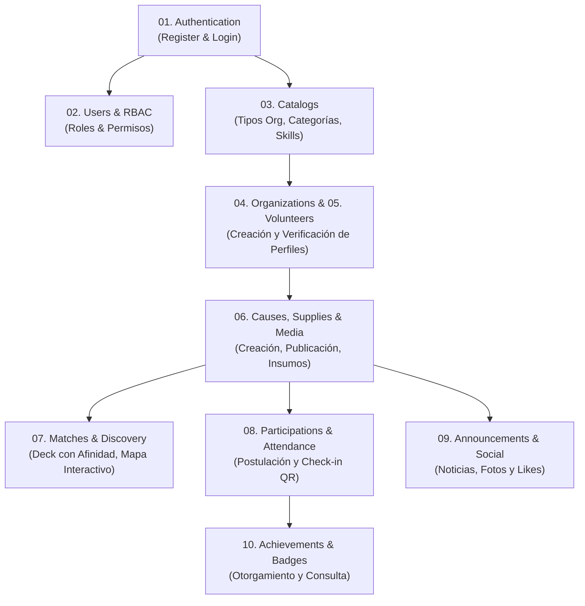

# Kindly Backend — Postman API Collection & Environment

Este directorio contiene la colección de Postman y el entorno local para la prueba integral de los endpoints HTTP del backend de Kindly (**NestJS + TypeORM + PostgreSQL**).

---

## 1. Archivos Incluidos

- **`Kindly-Backend.postman_collection.json`**: Colección completa estructurada en 10 carpetas modulares que representan todos los módulos y controladores implementados en la rama activa.
- **`Kindly-Local.postman_environment.json`**: Entorno local preconfigurado con variables base (`baseUrl`), tokens JWT dinámicos (`adminToken`, `volunteerToken`, `organizationToken`, `authToken`) e IDs de prueba.
- **`README.md`**: Esta guía de importación, configuración y ejecución.

---

## 2. Prerrequisitos de Ejecución

1. **Instancia de PostgreSQL Activa**:
   - Por defecto, la aplicación se conecta al puerto `5433` (o según variable `POSTGRES_PORT` en `.env`).
   - Base de datos configurada: `kindly_db`.
2. **Variables de Entorno del Backend (`server/.env`)**:
   - Verificar la configuración en `server/.env` (tomando como base `server/.env.example`).
   - El puerto por defecto configurado en `main.ts` es el **`3001`** (`process.env.PORT ?? 3001`). Por lo tanto, `baseUrl` en Postman apunta a `http://localhost:3001`.
3. **Servidor en Ejecución**:
   ```bash
   cd server
   npm run start:dev
   ```

---

## 3. Instrucciones de Importación en Postman

1. Abre **Postman**.
2. Haz clic en el botón **Import** (esquina superior izquierda).
3. Arrastra o selecciona los dos archivos JSON:
   - `Kindly-Backend.postman_collection.json`
   - `Kindly-Local.postman_environment.json`
4. En la esquina superior derecha de Postman, selecciona el entorno activo: **`Kindly - Local Environment`**.

---

## 4. Estructura de la Colección y Flujo Recomendado de Ejecución

Para ejecutar las pruebas en orden lógico respetando las dependencias de datos:



### Detalle de Carpetas

| Carpeta | Descripción | Autenticación Principal |
| :--- | :--- | :--- |
| **01. Authentication** | Registro de voluntarios y organizadores, login de roles y obtención de perfil actual. Las peticiones de Login guardan automáticamente los tokens en el entorno (`adminToken`, `volunteerToken`, `organizationToken`). | Pública / Bearer |
| **02. Users & RBAC** | Gestión administrativa de usuarios (filtros, activación, cambio de rol), roles, permisos y mapeo rol-permiso. | Admin (`adminToken`) |
| **03. Catalogs** | Tipos de organización, categorías temáticas y habilidades de voluntariado. | Pública / Admin |
| **04. Organizations** | Creación de perfil de organización, envío de documento de verificación, consulta de estado y aprobación administrativa. | Organizador (`organizationToken`) / Admin |
| **05. Volunteers** | Perfil de voluntario, asignación de habilidades y categorías de interés. | Voluntario (`volunteerToken`) / Admin |
| **06. Causes, Supplies & Media** | Creación de causas, publicación, verificación de cupos, insumos necesarios y galería fotográfica. | Organizador (`organizationToken`) |
| **07. Matches & Discovery** | Deck de causas con puntuación de afinidad (**US-3.2.3**), swipe right (postulación), swipe left (descarte) y mapa interactivo con pines y vista previa (**US-3.3.3**). | Voluntario (`volunteerToken`) |
| **08. Participations & Attendance** | Postulación de voluntarios a causas, aceptación/rechazo por organizador, generación de código QR y check-in presencial. | Voluntario / Organizador |
| **09. Announcements & Social** | Publicación de comunicados y noticias por causa, fotos adjuntas y sistema de likes comunitarios. | Organizador / Voluntario |
| **10. Achievements & Badges** | Consulta de insignias ganadas, creación de insignias por admin y otorgamiento a voluntarios destacados. | Voluntario / Admin |

---

## 5. Gestión de Tokens y Variables Dinámicas

Las peticiones clave incluyen scripts en la pestaña **Tests** para extraer y almacenar variables automáticamente:

- **`POST /auth/login` (Admin)**: Actualiza `adminToken`, `authToken` y `userId`.
- **`POST /auth/login` (Volunteer)**: Actualiza `volunteerToken`, `authToken` y `userId`.
- **`POST /auth/login` (Organizer)**: Actualiza `organizationToken`, `authToken` y `userId`.
- **`POST /causes`**: Almacena el `causeId` y el `attendanceQrCode` generado.
- **`POST /submissions`**: Almacena el `submissionId`.
- **`POST /organizations`**: Almacena el `organizerId`.
- **`POST /volunteers`**: Almacena el `volunteerId`.
- **`POST /achievements`**: Almacena el `achievementId`.

---

## 6. Auditoría de Rutas y Estado de Historias de Usuario

Durante la inspección del código fuente de la rama activa se verificaron las siguientes historias de usuario:

- **US-3.2.3 (Feed Personalizado por Afinidad)**:  
  **Implementado** en `GET /matches/deck` ([`server/src/matches/matches.controller.ts`](file:///c:/Users/HANNA%20MURIEL/Desktop/Universidad/Web/backend-kindly-app-262/server/src/matches/matches.controller.ts)). Calcula compatibilidad a partir de las habilidades y categorías de interés del voluntario vs. la causa.
- **US-3.3.3 (Navegación en Mapa y Vista Previa)**:  
  **Implementado** en `GET /matches/map/pins` y `GET /matches/map/preview/:causeId` ([`server/src/matches/matches.controller.ts`](file:///c:/Users/HANNA%20MURIEL/Desktop/Universidad/Web/backend-kindly-app-262/server/src/matches/matches.controller.ts)).
- **US-3.3.1 (Búsqueda de Causas por Palabra Clave)**:  
  **No implementado** en la rama activa. En [`server/src/causes/causes.controller.ts`](file:///c:/Users/HANNA%20MURIEL/Desktop/Universidad/Web/backend-kindly-app-262/server/src/causes/causes.controller.ts), el endpoint `GET /causes` no recibe parámetros de búsqueda de texto ni filtros ILIKE en `causes.service.ts`.
- **US-3.3.2 (Filtrado de Causas por Categoría)**:  
  **No implementado** en la rama activa. `GET /causes` no expone parámetro `category_id` en `causes.controller.ts` ni en su servicio.
